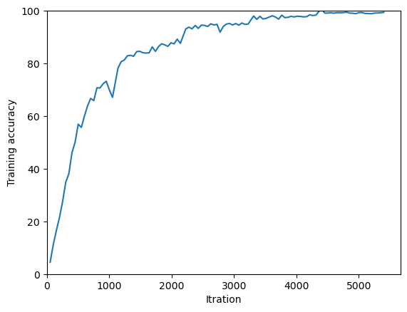

# Image Classification of American Sign Language

A PyTorch convolutional neural network for classifying 29 ASL alphabet image classes. This course project includes the training notebook, a Python script, and evaluation plots. The original experiment reported **97.56% accuracy on a held-out random test split** of the ASL Alphabet training image collection; this is not an evaluation of real-world signing or unseen signers.



Final project for:

- Course title: **EE 541 – Computational Introduction to Deep Learning**

- University: **University of Southern California (USC)**

- Instructor: **Dr. Brandon Franzke**

- Semester: **Fall 2022**

- Student Team: [**Kamiar Asgari**](https://github.com/kamiaras)

## Required Packages

- [PyTorch](https://pytorch.org/) and [Torchvision](https://pytorch.org/vision/stable/) 

- [Torch-Summary](https://pypi.org/project/torch-summary/)

- [Matplotlib](https://matplotlib.org/)

- [Pandas](https://pandas.pydata.org/)

- [Seaborn](https://seaborn.pydata.org/)

- [Numpy](https://numpy.org/)

## Running the project

1. Download and extract the [ASL Alphabet dataset](https://www.kaggle.com/grassknoted/asl-alphabet). Locate the training directory that contains the 29 class subdirectories.
2. Use a Jupyter environment with PyTorch and Torchvision for your platform, together with `torch-summary`, `matplotlib`, `pandas`, `seaborn`, and `numpy`.
3. Open [the notebook](Image_Classification_of_American_Sign_Language.ipynb). Before running it, configure the dataset directory and check the final model-save destination; both need to point to suitable locations on your computer.
4. Run the notebook cells in order.

The training code selects CUDA when available and otherwise selects the CPU. It is configured for five epochs and displays evaluation plots. Package versions from the original experiment were not recorded, so this describes the existing workflow rather than a newly verified environment.

[The `.py` file](Image_Classification_of_American_Sign_Language.py) is a notebook export, not a ready-to-run standalone script. It contains the IPython-only `%%capture` cell magic and hard-coded paths in `DATA_ROOT_FOLDER` and the final `torch.save` call. Using it with ordinary Python requires removing the notebook-only magic and configuring both the dataset and model-output paths; that standalone workflow has not been verified here.

## Table of contents

- [Dataset](#dataset) 

- [Data Handling](#data-handling)

- [Model](#model)

- [Training Parameters](#training-parameters)

- [Results](#results)

- [Acknowledgements](#acknowledgements)

- [License](#license)


## Dataset

The dataset used for this project was created by [Akash Nagaraj](https://github.com/grassknoted). It is available on Kaggle as the [ASL Alphabet](https://www.kaggle.com/grassknoted/asl-alphabet) Dataset.

### About the Dataset

The data set is a collection of images of alphabets from the American Sign Language, separated in 29 folders which represent the various classes.

- The training data set contains 87,000 images which are 200x200 pixels. There are 29 classes, of which 26 are for the letters *"A"* through *"Z"* and 3 classes for *"SPACE"*, *"DELETE"* and *"NOTHING"*.

- The dataset also supplies 29 test images. The reported accuracy below uses the random held-out split of the training image collection, not this separate 29-image set.

## Data Handling

We used a generic data loader called `ImageFolder` imported from `torchvision` library. It works well when the images are arranged similarly to our data-set.
```python
from torchvision import datasets
data_set = datasets.ImageFolder(<PATH to DATA FOLDER>, transform=transforms.ToTensor())
```
Using `torch.utils.data.random_split`, the data-set is divided into three parts: *training*, *testing*, and *validation*, with ratios of 80%, 10%, and 10%, respectively.
```python
train_test_val_split = [0.8, 0.1, 0.1]
train_set, test_set, val_set = torch.utils.data.random_split(data_set,
                                [round(p * len(data_set)) for p in train_test_val_split],
                                generator=torch.Generator().manual_seed(42))
```
We fixed the generator for a reproducible dataset split with `generator=torch.Generator().manual_seed(42)` (*here 42 is an arbitrary number*). This seed alone does not make model training reproducible. After splitting the data-set, corresponding data-loaders were created with `torch.utils.data.DataLoader` and a batch size of `batch_size=64`.

### Optional Garbage Collection

Using `gc` library, it is possible to remove unwanted variables that are stored in RAM. For example after creating the data-loaders, we can remove the following variables: `data_set`, `train_set`, `test_set`, and `val_set`.
```python
import gc
del data_set
del train_set
del test_set
del val_set
gc.collect()
```

## Model

We employed a Convolutional Neural Network (CNN) with three hidden layers. 

- ***Input layer:*** Image 200 (height) x 200 (width) x 3 (RGB channels) .

- ***Hidden layer #1:*** `Conv2d(kernel_size=(5,5),out_channels=32,in_channels=3)` &rarr; `ReLU` &rarr; `MaxPool2d(2,2)`.

- ***Hidden layer #2:*** `Conv2d(kernel_size=(3,3),out_channels=64,in_channels=32)` &rarr; `ReLU` &rarr; `MaxPool2d(2,2)`.

- &rarr; **`Flatten`** &rarr;

- ***Hidden layer #3:*** `Linear(147456,128)` &rarr; `ReLU`.

- ***Output layer:*** `Linear(128,29)`, producing one logit for each class.

However, we did not include the last `Softmax` function in our model because the `CrossEntropyLoss` function implemented in `PyTorch` will take it into account on its own during training. For prediction, the class with the largest output logit is selected using `argmax`; applying softmax does not change that class.

Using `Torch-Summary` we can generate a description of our model:
```python
from torchsummary import  summary
summary(model=model, input_size=(3,200,200), batch_size=batch_size)
```
```python
----------------------------------------------------------------
        Layer (type)               Output Shape         Param #
================================================================
            Conv2d-1         [64, 32, 196, 196]           2,432
         MaxPool2d-2           [64, 32, 98, 98]               0
            Conv2d-3           [64, 64, 96, 96]          18,496
         MaxPool2d-4           [64, 64, 48, 48]               0
            Linear-5                  [64, 128]      18,874,496
            Linear-6                   [64, 29]           3,741
================================================================
Total params: 18,899,165
Trainable params: 18,899,165
Non-trainable params: 0
----------------------------------------------------------------
```

## Training Parameters

A *batch size* of `batch_size=64` is chosen (as mentioned in the section [Data Handling](#data-handling).) The selected *Loss function* is *Cross-Entropy Loss*, which is a common solution for multiclass classification problems.
```python
loss_func = nn.CrossEntropyLoss()
```
Stochastic Gradient Descent (SGD) was chosen as the optimizer algorithm with an initial *learning rate* of `lr=0.05` and a *momentum* of `momentum=0.9`.
```python
optimizer = optim.SGD(model.parameters(), lr=0.05, momentum=0.9)
```
The learning rate scheduler modifies the *learning rate* by multiplying it by `gamma=0.7` after each epoch (`step size=1`).
```python
scheduler = optim.lr_scheduler.StepLR(optimizer, step_size=1, gamma=0.7)
```
We ran the algorithm for five *epochs* (`num_epochs=5`).

## Results

Our algorithm was tested on a `cuda` device, a *NVIDIA Quadro RTX 5000* graphics card. In the original experiment, training took about 15 minutes on this GPU versus 74 minutes on an AMD Ryzen 7 PRO 5850U CPU, approximately a fivefold speedup.

### Final Model

The original experiment reported the following accuracies on the 80%/10%/10% random split of the training image collection described above:

- Accuracy in the training data-set: 99.64%. 

- Accuracy in the validation data-set: 97.41%.

- Accuracy on the held-out test split: 97.56%. 

These figures describe a random image split within this dataset. They do not establish performance on new signers, new capture conditions, or continuous sign language.

For the testing data-set, the confusion matrix was computed. For this matrix, a [heatmap](Full_Confusion_Matrix.png) was created. To make off-diagonal errors easier to inspect, we also plotted a second matrix with its diagonal entries set to zero. This [error-focused heatmap](diog_zeroed_conf_matr.png) complements the full confusion matrix.

### Training time

The *Loss* and the *Accuracy* of each group of 50 iterations (50 batches)  were averaged and plotted in the following graph: [Training_Time_Loss](Training_Time_Loss.png) and [Training_Time_Accuracy](Training_Time_Accuracy.png) respectively.

## Acknowledgements

We'd like to thank [Zalan Fabian](https://z-fabian.github.io/) and [Berk Tinaz](mailto:tinaz@usc.edu) for their help and advice.

## License

[MIT](LICENSE)
